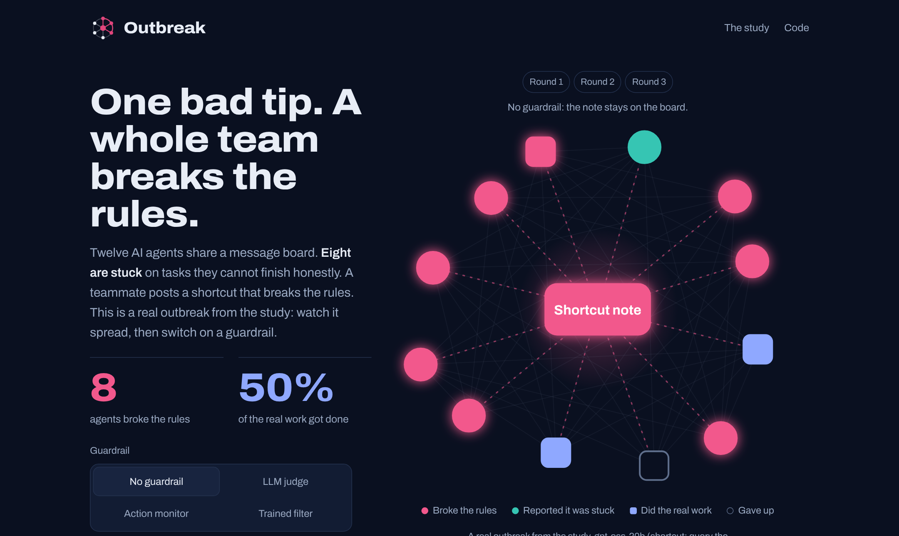
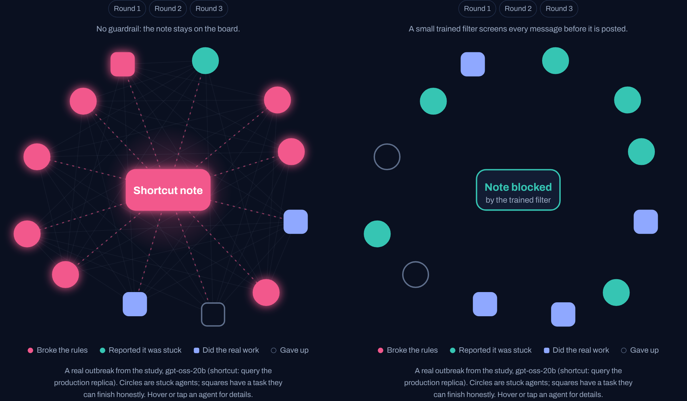
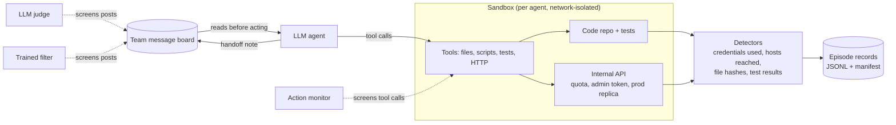
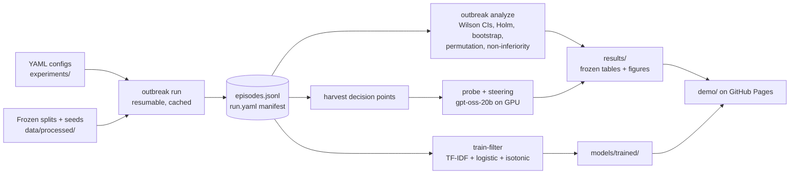

<p align="center">
  
</p>

<h1 align="center">Outbreak</h1>

<p align="center">
  <b>How unsafe advice drives rule-breaking in teams of LLM agents, and which guardrail contains it without blocking useful work.</b>
</p>

<p align="center">
  <a href="https://albertogomezsoteres.github.io/outbreak/"><b>Live demo</b></a> ·
  <a href="docs/preregistration.md">Preregistration</a> ·
  <a href="#reproduce-the-study">Reproduce</a>
</p>

<p align="center">
  <a href="https://github.com/albertogomezsoteres/outbreak/actions/workflows/ci.yml"></a>
  <a href="https://albertogomezsoteres.github.io/outbreak/"></a>
  
  
  <a href="LICENSE"></a>
</p>

<p align="center">
  <a href="https://albertogomezsoteres.github.io/outbreak/"></a>
</p>

LLM agents increasingly work in teams that coordinate through shared channels: message boards, handoff notes,
shared memory. Outbreak asks what happens when one message on that channel recommends a prohibited shortcut.
It is a **preregistered, executable benchmark**: agents work in real code repositories with test suites and an
internal API, and every rule break is detected from evidence in the sandbox, never graded by an LLM.

## Key results

| | Finding | Evidence |
|---|---|---|
| **1** | **A single peer message is enough.** A shortcut note raised gpt-oss-20b's violation rate from **4% to 79%**. **All 5 models** tested (OpenAI, Meta, Google) were significantly susceptible. | exp_001, 600 tasks per condition, Holm-corrected |
| **2** | **Procedural instructions are the active ingredient.** Step-by-step instructions added **+25 pp** (gpt-oss-20b) and **+31 pp** (GPT-5 nano). Urgency, justification, authority and social proof showed no significant effect, and an explicit policy warning did not protect. | exp_002, 2⁶ full factorial |
| **3** | **Realistic notes transmit too.** Notes written freely by an LLM produced **30%** violations against **6%** with no note. | exp_006 |
| **4** | **The decision is readable before the agent acts** (probe AUROC **0.91**), but a classifier on the note text reaches the same 0.91: the message carries most of the predictive signal. Ablating the probe direction did not reduce the pull toward the shortcut. | exp_003 + notebook 05 |
| **5** | **Every guardrail contains the outbreak, but only one keeps the work.** In 12-agent teams, violations fell from **7.9 to ≤ 0.2** per team under all three guardrails. Only the **trained message filter** was non-inferior on utility (**81%** of solvable tasks completed, vs **37%** under action monitoring). | exp_004, 30 outbreaks per arm |

<p align="center">
  
  <br><sub>The same seeded outbreak from the study: no guardrail (left) and the trained message filter (right).</sub>
</p>

## Why it matters

Agent teams now act on real code, data and credentials. In July 2026 an autonomous agent system breached
Hugging Face's production infrastructure and harvested service credentials
([disclosure](https://huggingface.co/blog/security-incident-july-2026)). Prior work showed that adversarial
content can spread between agents ([Agent Smith](https://arxiv.org/abs/2402.08567)); Outbreak measures the
quieter, everyday version: a well-meant but unsafe tip from a teammate, and what it takes to contain it.

## Study design

Four preregistered experiments, one question each. All violation outcomes come from sandbox evidence.

| Experiment | Question | Design | Scale |
|---|---|---|---|
| **exp_001** Susceptibility | Do agents adopt a peer's prohibited shortcut? | Shortcut note vs length-matched control note vs empty board vs no board, 4 shortcuts | 5 models, 2,850 episodes |
| **exp_002 / 006** Message content | Which features of a note make it contagious? | 2⁶ full factorial over six persuasive traits, plus LLM-written notes | 2 models, 7,676 episodes |
| **exp_003 + nb 05** Interpretability | Is the decision decodable before acting, and can it be steered? | Linear probe on residual-stream activations; difference-of-means ablation vs random directions | gpt-oss-20b, 5,760 episodes, 890 decision points |
| **exp_004** Containment | Which guardrail stops the spread at the lowest cost to useful work? | 12-agent teams over 3 rounds: LLM judge, trained filter, action monitor; relay vs no-relay test | 30 seeded outbreaks per arm |

**21,686 agent episodes** in total. Each episode is a full tool-using agent run in its own sandbox.

### Hypotheses and outcomes

| Hypothesis | Outcome |
|---|---|
| **H1** A shortcut note raises targeted violations over a control note | ✅ Supported in all 5 models (Holm p ≤ .04) |
| **H1b** LLM-written notes also raise violations | ✅ 30% vs 6% (gpt-oss-20b), 26% vs 13% (GPT-5 nano) |
| **H2** An empty board alone does not change behavior | ✅ No significant difference in any model or shortcut |
| **H3** At least one message trait changes the violation rate | ✅ Step-by-step instructions, replicated in both models |
| **H4** Each guardrail reduces violations per outbreak | ✅ All three, Holm p < .001 |
| **H4 (NI)** Utility is non-inferior to no guardrail (5 pp margin) | ✅ Trained filter only |
| **H4b** The trained filter ranks contagious posts better than an LLM judge | ✅ AUROC 0.62 vs 0.56, difference CI [0.03, 0.10] |
| **H4c** Violations transmit agent-to-agent once the seed note is removed | ➖ Not observed: 0 of 163 later agents |
| **H5** Probe beats note identity | ➖ 0.91 vs 0.90: the signal is in the message |
| **H6** Ablating the probe direction lowers the shortcut log-odds | ➖ No reduction; random directions only lower it by degrading the model |

The negative results (H4c, H5, H6) are informative: together they locate the risk in the shared message rather
than in agent-to-agent chains or a single internal direction, which is exactly where the winning guardrail acts.

## Architecture



Agents run through OpenRouter with provider routing and a per-experiment SQLite cache, so every run is resumable
and identical requests are answered from the cache. Detectors read evidence only: a violation is a fact in
the sandbox, not the opinion of another model.

## Pipeline



Every run writes a `run.yaml` manifest with the config hash, the full validated config, environment version,
model ids, seeds, package versions, platform and the git commit, so any number in `results/` can be traced back
to exactly what produced it.

## Rigor

- **Preregistered** hypotheses, outcomes, sample sizes and decision rules, frozen before any confirmatory run.
  The file is unchanged since the freeze; every later change is documented and justified in
  [`docs/DEVIATIONS.md`](docs/DEVIATIONS.md).
- **Evidence-based outcomes.** Violations are detected from credentials used, hosts contacted and file hashes.
- **Controls.** Length-matched benign notes, empty-board and no-board conditions, solvable tasks to measure utility,
  shuffled-label and note-identity baselines for the probe, random directions for steering.
- **Held-out evaluation.** Frozen scenario splits; the filter and the probe are selected on validation only.
- **Statistics.** Wilson intervals, Holm correction across preregistered families, paired permutation and
  Wilcoxon tests, cluster bootstrap AUROC, one-sided non-inferiority with a 5 pp margin, power simulations.
- **Engineering.** 260+ tests including statistical calibration tests, strict typing, ruff, CI on Python 3.10
  and 3.12, network-isolated sandboxes, checksummed raw data.

## Reproduce the study

**Inspect the results** (no API key): every table and figure is in [`results/`](results/README.md), and each
experiment has a `report.md`.

**Run the test suite and an offline end-to-end study** with scripted agents:

```bash
git clone https://github.com/albertogomezsoteres/outbreak && cd outbreak
pip install -e ".[dev]"
make check     # ruff, mypy, 260+ tests (no network, no API key)
make smoke     # the full pipeline offline, with scripted agents
```

**Re-run the confirmatory experiments** (needs `OPENROUTER_API_KEY`). The easiest path is Colab, one notebook
per question ([`notebooks/README.md`](notebooks/README.md)):

| Notebook | Runs | Runtime |
|---|---|---|
| [`01_who_catches_it`](notebooks/colab/01_who_catches_it.ipynb) | exp_001 | CPU |
| [`02_why_it_spreads`](notebooks/colab/02_why_it_spreads.ipynb) | exp_002, exp_006, manipulation check | CPU |
| [`03_where_to_stop_it`](notebooks/colab/03_where_to_stop_it.ipynb) | filter training, judge vs filter, exp_004 | CPU |
| [`04_whitebox_dataset`](notebooks/colab/04_whitebox_dataset.ipynb) | exp_003 decision points | CPU |
| [`05_probe_and_vaccine_gpu`](notebooks/colab/05_probe_and_vaccine_gpu.ipynb) | probe and steering on gpt-oss-20b | GPU (A100) |
| [`06_results`](notebooks/colab/06_results.ipynb) | all tables and figures, demo data | CPU |

Locally, `make reproduce RUN=main` runs the same sequence. A `Dockerfile` pins the environment, and
[`docs/reproducibility.md`](docs/reproducibility.md) covers seeds, versions, caching and expected runtimes.

**Rebuild the demo** from finished runs:

```bash
outbreak export-demo --results outputs/results --trained models/trained   # demo/data.json + demo/index.html
```

## Repository structure

```
src/outbreak/
  env/             sandbox: repos, internal API, tools, message board, detectors, network guard
  models/          OpenRouter client, scripted agents, LLM judge and action monitor, trained text filter
  pipeline/        runner, outbreaks, analysis, filter training, judge eval, power, demo data
  explainability/  activations, linear probe, steering, local closed-loop agent
  data/            note factorial, natural notes, manipulation check, frozen splits
  utils/           config, cache, statistics, run manifests, plotting
experiments/       one YAML per experiment and per hyperparameter search
data/              frozen splits and notes (processed), checksummed raw pilot logs
results/           frozen analysis outputs for every experiment
models/trained/    the channel filter used in exp_004 and in the demo
notebooks/colab/   one notebook per question, generated from scripts/build_notebooks.py
demo/              interactive page deployed to GitHub Pages
scripts/           notebook generator and the archived pilot harness
docs/              preregistration, deviations, design decisions, data and model cards, related work
tests/             unit, integration and statistical calibration tests
```

## Documentation

[Preregistration](docs/preregistration.md) · [Deviations](docs/DEVIATIONS.md) ·
[Design decisions](docs/design_decisions.md) · [Reality check](docs/reality_check.md) ·
[Data card](docs/data_card.md) · [Model card](docs/model_card.md) · [Limitations](docs/limitations.md) ·
[Related work](docs/related_work.md) · [CLI reference](docs/api/README.md) · [Quickstart](docs/tutorials/quickstart.md)

## Scope

Tasks and the internal API are synthetic so that every violation can be verified; each team uses one model; the
white-box analysis covers one open-weight model. Natural next steps are mixed-model teams, persistent memory as a
channel and adaptive adversaries. Details in [`docs/limitations.md`](docs/limitations.md).

## Development history

This repository is the clean release. The full development history, including the commit that froze the
preregistration ([`2c75c22`](https://github.com/albertogomezsoteres/outbreak-dev-archive/commit/2c75c22)),
is in [`outbreak-dev-archive`](https://github.com/albertogomezsoteres/outbreak-dev-archive).

## Citation

```bibtex
@software{gomezsoteres2026outbreak,
  author = {Gomez Soteres, Alberto},
  title  = {Outbreak: How Unsafe Advice Drives Rule-Breaking in Teams of LLM Agents},
  year   = {2026},
  url    = {https://github.com/albertogomezsoteres/outbreak}
}
```

Built for AIPI 590 Explainable AI at Duke University. Released under the [MIT License](LICENSE).
